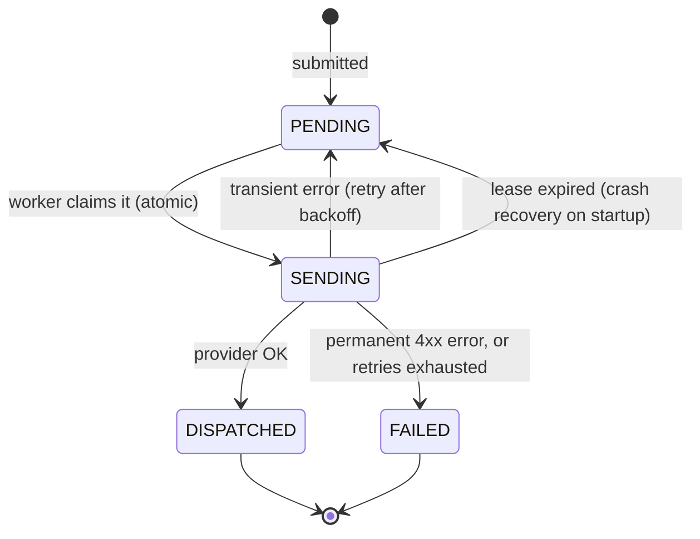
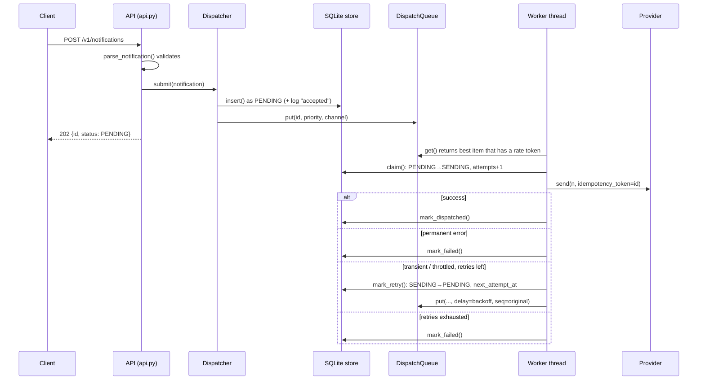

# Distributed Notification & Alerting Service

A small, self-contained backend service that accepts **SMS, Email and Push**
notifications over HTTP and delivers them to downstream providers while
guaranteeing four things:

1. **Priority routing**: critical alerts (password resets, 2FA codes, outage
   pages) are sent **before** marketing traffic, even if they arrive later.
2. **Rate limiting**: the service never sends faster than each provider allows,
   so it does not get throttled (HTTP 429).
3. **Retries with exponential backoff**: temporary provider failures are
   retried with growing, randomized delays. Permanent failures are not retried.
4. **No double sends**: every state change is recorded atomically in SQLite,
   so a notification is never delivered twice, even with many worker threads,
   duplicate client requests or a crash in the middle of sending.

It is written in **pure Python 3.10+ using only the standard library**. There is
nothing to `pip install`.

---

## Table of contents

1. [Quick start](#1-quick-start)
2. [Project layout](#2-project-layout)
3. [Core concepts](#3-core-concepts)
4. [Architecture](#4-architecture)
5. [Life of a notification, step by step](#5-life-of-a-notification-step-by-step)
6. [Module-by-module walkthrough](#6-module-by-module-walkthrough)
7. [Database schema](#7-database-schema)
8. [HTTP API reference](#8-http-api-reference)
9. [Command-line interface](#9-command-line-interface)
10. [Configuration and default values](#10-configuration-and-default-values)
11. [The demo explained](#11-the-demo-explained)
12. [Tests](#12-tests)
13. [VS Code setup](#13-vs-code-setup)
14. [Extending the service](#14-extending-the-service)
15. [Known limitations](#15-known-limitations)
16. [Scaling beyond one machine](#16-scaling-beyond-one-machine)
17. [Glossary](#17-glossary)
18. [Troubleshooting](#18-troubleshooting)

---

## 1. Quick start

**Requirements:** Python 3.10 or newer (tested on 3.12). No other dependencies.

```bash
# 1. Watch priority routing and retries happen in a self-contained demo
python3 -m notifier demo

# 2. Run the HTTP API + background dispatcher on http://127.0.0.1:8080
python3 -m notifier serve --port 8080

# 3. Run the full test suite (31 tests, about 12 seconds)
python3 -m unittest discover -s tests -t . -v
```

With the server running, send a notification from another terminal:

```bash
curl -X POST http://127.0.0.1:8080/v1/notifications \
  -H 'Content-Type: application/json' \
  -H 'Idempotency-Key: pwreset-user-42' \
  -d '{"channel":"email","recipient":"user42@example.com",
       "subject":"Reset your password","body":"Click here...","priority":"critical"}'
# -> 202 {"id": "ca99340d...", "status": "PENDING", "priority": 1, "duplicate": false}

curl http://127.0.0.1:8080/v1/notifications/<id>   # status + full audit history
curl http://127.0.0.1:8080/v1/stats                # counts and metrics
```

> **Note:** the providers are **mocks** (fake Twilio / SES / push). Nothing is
> actually sent to a phone or inbox. See [Extending](#14-extending-the-service)
> for how to plug in real providers.

---

## 2. Project layout

```
notification-service/
├── notifier/                    # the service (a Python package)
│   ├── __init__.py              # public exports of the package
│   ├── __main__.py              # CLI: `python -m notifier serve | demo`
│   ├── api.py                   # HTTP server, request parsing and validation
│   ├── app.py                   # wiring: builds store + providers + limiters + dispatcher
│   ├── dispatcher.py            # worker threads: claim, send, then retry / finish
│   ├── models.py                # data types: Notification, Priority, Channel, Status
│   ├── priority_queue.py        # in-memory, rate-aware priority queue (heapq)
│   ├── providers.py             # mock SMS/Email/Push providers + error types
│   ├── rate_limiter.py          # token-bucket rate limiter
│   ├── retry.py                 # exponential backoff policy with jitter
│   └── store.py                 # SQLite persistence and atomic state transitions
├── tests/
│   ├── helpers.py               # make_dispatcher() factory with fast settings
│   ├── test_api.py              # end-to-end HTTP tests
│   ├── test_dispatcher.py       # retries, failures, concurrency, restart
│   ├── test_priority_queue.py   # ordering, delays, per-channel fairness
│   ├── test_rate_limit_and_retry.py  # token bucket + backoff math
│   └── test_store.py            # idempotency, claim races, audit log, leases
├── requests.http                # ready-made requests for VS Code "REST Client"
├── .vscode/                     # launch configs, test settings, recommended extensions
├── .gitignore                   # ignores __pycache__, *.db, *.db-wal, *.db-shm, .venv
└── README.md
```

The SQLite database file (`notifications.db` by default) is created on first
run in the current directory and is git-ignored.

---

## 3. Core concepts

### Channels

`Channel` (in `models.py`) is the delivery medium. Each channel has its own
provider and its own rate limit.

| Channel | Value in JSON | Real-world equivalent | Mock provider limit |
|---|---|---|---|
| SMS | `"sms"` | Twilio | 10 requests/s |
| Email | `"email"` | Amazon SES | 50 requests/s |
| Push | `"push"` | SNS Mobile Push / FCM / APNs | 100 requests/s |

### Priorities

`Priority` is an integer enum. **A lower number means more urgent.** This
matches Python's `heapq`, which always pops the smallest item first.

| Level | Name | Typical use |
|---|---|---|
| 1 | `CRITICAL` | Security and operations: password resets, 2FA codes, outage pages |
| 2 | `TRANSACTIONAL` (default) | Order confirmations, shipping updates |
| 3 | `MARKETING` | Batch campaigns, promotions |

The API accepts the number (`1`, `"1"`) or the name in any case (`"critical"`,
`"Marketing"`).

### Statuses

Every notification is always in exactly one of four states:

| Status | Terminal? | Meaning |
|---|---|---|
| `PENDING` | no | Waiting to be sent, either new or waiting for a retry |
| `SENDING` | no | Claimed by exactly one worker, which is currently calling the provider |
| `DISPATCHED` | **yes** | The provider accepted it. Done. |
| `FAILED` | **yes** | Permanent error, or every retry was used up. Done. |



`SENDING` is an internal state on top of the usual PENDING / DISPATCHED /
FAILED. It works as a **lock**: only the worker that moved a row into
`SENDING` may send it or move it on. This is what makes "send at most once"
enforceable across threads and processes.

### Idempotency (two separate layers)

"Idempotent" means that doing something twice has the same effect as doing it
once. The service uses it in two places:

1. **Client → service (`Idempotency-Key`).** If a client sends the same request
   twice (for example after a network timeout), the second request does
   not create a second notification. It returns the original one.
2. **Service → provider (idempotency token).** When calling a provider, the
   service passes the notification's `id` as a token. If the service crashes
   *after* the provider accepted the message but *before* the database was
   updated, the resend after restart carries the same token, and the provider
   drops it as a duplicate.

---

## 4. Architecture

```
 POST /v1/notifications ─┐                        ┌─► MockProvider(SMS)   10/s hard limit
 POST /v1/.../batch ─────┼─► Dispatcher.submit    │
                         │     │ INSERT PENDING   ├─► MockProvider(EMAIL) 50/s
                         │     ▼ (idempotency key)│
                         │  SQLite (WAL) ◄──┐     └─► MockProvider(PUSH) 100/s
                         │     │            │ claim / mark_* (atomic CAS)
                         │     ▼            │
                         │  DispatchQueue ──► N worker threads
                         │  heapq per channel + token bucket gate
 GET /v1/notifications/id┘  + delayed heap for retry backoff
```

There are two sources of truth, each with its own job:

| Component | Role | Survives restart? |
|---|---|---|
| **SQLite database** (`store.py`) | The real source of truth: every notification, its status and its full history | Yes |
| **DispatchQueue** (`priority_queue.py`) | A fast in-memory to-do list that decides *what to send next* | No. It is rebuilt from the database on startup. |

Keeping the queue in memory makes ordering decisions fast. Because every
decision is confirmed against the database (the *claim*), a stale or
duplicated queue entry can never cause a double send.

### Threads

* **HTTP threads**: `ThreadingHTTPServer` handles each request on its own
  thread. These threads only insert rows and push to the queue. They never
  call providers, so the API responds quickly.
* **Worker threads** (`dispatch-worker-0..N`, 8 by default): loop forever,
  taking the best sendable item from the queue and processing it.

### How each requirement is met

| Requirement | Where | How |
|---|---|---|
| Priority routing | `priority_queue.py` | `heapq` keyed by `(priority, seq)`. Level 1 always pops before Level 3, and `seq` keeps FIFO order within a level. Retries wait in a separate *delayed* heap, so a backing-off item never blocks ready work. |
| Rate limiting | `rate_limiter.py`, `priority_queue.py` | A token bucket per channel at 80% of the provider's limit. The queue only hands out an item whose channel has a token, so an exhausted SMS budget doesn't stall email, and workers never sleep while holding work. |
| Exponential backoff | `retry.py`, `dispatcher.py` | `min(cap, base·2ⁿ)` with **full jitter** to avoid synchronized retry storms. Honours the provider's `Retry-After` on HTTP 429. Permanent 4xx-style errors fail immediately. |
| Atomic status log | `store.py` | `BEGIN IMMEDIATE` transactions. Every transition writes its `dispatch_log` audit row in the same transaction. |
| No double sends | `store.py: claim()` | `UPDATE … SET status='SENDING' WHERE id=? AND status='PENDING'` is a compare-and-set: exactly one worker sees `rowcount == 1`. Only the claim holder can move the row to a terminal state. |
| Crash safety | `store.recover_expired_leases`, `Dispatcher.start` | Claims carry a lease. On startup, expired `SENDING` rows go back to `PENDING` and all `PENDING` rows are reloaded into the queue. The row id is sent as the provider idempotency token, so a resend after a crash mid-send is dropped by the provider. |
| Client retries | `store.insert` | `Idempotency-Key` header → `UNIQUE` column → `ON CONFLICT DO NOTHING`. Repeat requests return the original id. |

---

## 5. Life of a notification, step by step



In words:

1. **Receive.** The HTTP handler reads the JSON body (max 1 MiB) and
   `parse_notification()` validates it: channel, priority, recipient, body
   length and an email subject.
2. **Persist.** `Dispatcher.submit()` calls `store.insert()`, which writes the
   row as `PENDING` and adds an `accepted` entry to the audit log in **one
   transaction**. If the idempotency key was already used, nothing is inserted
   and the existing row is returned.
3. **Enqueue.** A newly created row is pushed onto the in-memory
   `DispatchQueue`. The client immediately gets **202 Accepted** with the id.
   Delivery happens in the background.
4. **Pick.** A worker calls `queue.get()`. The queue looks at the front item of
   each channel's heap, in priority order, and returns the first one whose
   channel's **token bucket** has a token. If none do, the worker waits exactly
   until the soonest token or delayed retry becomes available.
5. **Claim.** The worker calls `store.claim(id)`. This atomic
   `UPDATE … WHERE status='PENDING'` flips the row to `SENDING`, increments
   `attempts` and sets a 30-second lease. If it fails (another worker already
   claimed the row, or it is already finished), the worker simply drops the item.
6. **Send.** The worker calls `provider.send(notification, idempotency_token=id)`.
7. **Record the outcome:**
   * **Success** → `mark_dispatched()` stores the provider's message id. Terminal.
   * **`PermanentProviderError`** (for example an invalid phone number) →
     `mark_failed()`. Terminal, never retried.
   * **Any other exception** (503, timeout, 429, unexpected bug):
     * if `attempts >= max_attempts` (5) → `mark_failed("gave up after N attempts")`;
     * otherwise compute a backoff delay (at least the provider's `Retry-After`
       for a 429), call `mark_retry()` to set the row back to `PENDING` with
       `next_attempt_at`, and put the item back in the queue's **delayed heap**
       with its **original `seq`**, so it keeps its FIFO place once the delay is over.
8. **Track.** At any time `GET /v1/notifications/{id}` returns the current row
   plus every transition from `dispatch_log`.

---

## 6. Module-by-module walkthrough

### `notifier/models.py`: data types

* **`Priority(IntEnum)`**: `CRITICAL=1`, `TRANSACTIONAL=2`, `MARKETING=3`.
  `Priority.parse(value)` accepts ints, digit strings (`"2"`) or names
  (`"critical"`, case-insensitive). It raises `KeyError`/`ValueError` for
  anything else.
* **`Channel(str, Enum)`**: `SMS="sms"`, `EMAIL="email"`, `PUSH="push"`.
  Because it inherits `str`, its values serialise directly to JSON and SQL.
* **`Status(str, Enum)`**: the four states described above. `TERMINAL` is the
  set `{DISPATCHED, FAILED}`.
* **`Notification` (dataclass)**: one message plus its delivery bookkeeping:

  | Field | Meaning |
  |---|---|
  | `id` | Random 32-hex UUID, generated automatically |
  | `channel`, `recipient`, `body`, `subject` | What to send and where |
  | `priority` | Defaults to `TRANSACTIONAL` |
  | `idempotency_key` | Optional client-supplied dedupe key |
  | `status` | Current state (starts `PENDING`) |
  | `attempts` | Number of times a worker has claimed it (incremented on each claim) |
  | `created_at`, `updated_at` | Unix timestamps (seconds, float) |
  | `next_attempt_at` | When a retry becomes due (Unix time; `0` = immediately) |
  | `dispatched_at`, `provider_message_id` | Set on success |
  | `last_error` | Last failure message, cleared on success |

  `to_dict()` converts it to JSON-friendly form for the API.

### `notifier/rate_limiter.py`: token bucket

A **token bucket** is a classic rate-limiting algorithm. Picture a bucket that
holds at most `capacity` tokens and refills continuously at `rate` tokens per
second. Every send takes one token. If the bucket is empty, you wait.

* `capacity` sets the **burst**: how many sends can go out back-to-back after
  an idle period.
* `rate` sets the **long-run average** speed.

`TokenBucket(rate, capacity=None, clock=time.monotonic)`:

* `try_acquire(tokens=1.0) -> float`: **never blocks.** It refills the bucket
  based on elapsed time, then either takes a token and returns `0.0`, or
  returns the number of seconds until a token will be available. The queue uses
  that number to know exactly how long to wait.
* `acquire(tokens=1.0, timeout=None) -> bool`: blocking version (sleeps until
  a token is available, or returns `False` on timeout). It is not used by the
  dispatcher, but is handy elsewhere.
* It is thread-safe (internal lock). It uses a monotonic clock, so changes to
  the system time do not affect it. The clock can be injected for tests.
* It validates its input: `rate > 0` and `capacity >= 1`.

### `notifier/retry.py`: backoff policy

`RetryPolicy` is a frozen dataclass:

| Field | Default | Meaning |
|---|---|---|
| `max_attempts` | 5 | Total tries (first try + 4 retries) before giving up |
| `base_delay` | 0.5 s | Delay ceiling after the first failure |
| `max_delay` | 30 s | Upper cap for any delay |
| `multiplier` | 2.0 | Growth factor per attempt |
| `jitter` | True | Use "full jitter" randomisation |

`backoff(attempt)` with `attempt` = number of tries already made (1-based):

```
ceiling = min(max_delay, base_delay * multiplier ** (attempt - 1))
delay   = random.uniform(0, ceiling)   if jitter else ceiling
```

With the defaults, the ceilings are **0.5 s → 1 s → 2 s → 4 s**, and then the
5th failure is final.

**Why jitter?** If a provider goes down for a moment, hundreds of messages fail
at the same instant. Without randomness they would all retry at the same
instant too, and could knock the provider over again (a "thundering herd").
"Full jitter" spreads the retries uniformly across the window.

`exhausted(attempt)` returns `True` once `attempt >= max_attempts`.

### `notifier/providers.py`: providers and error types

**Error hierarchy.** This is how the dispatcher decides whether to retry:

```
ProviderError                      (retryable = True)
├── TransientProviderError         5xx, timeouts, connection resets  → retry
│   └── ThrottledError             HTTP 429; has .retry_after        → retry, wait ≥ retry_after
└── PermanentProviderError         4xx, e.g. invalid number          → FAILED immediately
```

Any exception that is *not* a `PermanentProviderError` is treated as
retryable. That is the safe default for unknown errors.

**`MockProvider`** stands in for Twilio / SES / push services. It behaves like
a real provider so the guarantees can be tested:

* It enforces its **own hard rate limit** with an internal `TokenBucket` and
  raises `ThrottledError` (429) when it is exceeded. Tests use this to prove the
  dispatcher's client-side limiter keeps us below the provider's limit.
* It **honours idempotency tokens**: if a token was already delivered, it
  returns the original message id and counts `duplicates_suppressed` instead
  of delivering again.
* It simulates random latency (5–20 ms by default) and random transient `503`s
  at `failure_rate`.
* Any recipient starting with **`invalid`** (for example `"invalid-number"`)
  triggers a `PermanentProviderError` (400). Use it to test the failure path.
* `script(recipient, *errors)` makes the next N sends to that recipient raise
  the given errors in order. Tests use it to produce exact retry scenarios.
* Counters for inspection: `calls`, `throttled`, `duplicates_suppressed`, and
  `deliveries` (a list of `(monotonic_time, notification)` actually delivered).

### `notifier/priority_queue.py`: the rate-aware priority queue

This is the heart of priority routing. Internally it holds:

* **One "ready" min-heap per channel**, ordered by `(priority, seq)`.
* **One "delayed" min-heap**, ordered by `(ready_at, priority, seq)`, for items
  waiting out a retry backoff.
* **A membership set** of ids, so the same notification can't be queued twice.
* **A condition variable** (`threading.Condition`) that lets workers sleep
  efficiently and wake up when work arrives.

`seq` is a global, ever-increasing counter. Two items with the same priority
are therefore served **first in, first out**. A retried item is re-queued with
its *original* `seq`, so it does not lose its place in line.

**`put(id, priority, channel, delay=0, seq=None)`** adds to the ready heap, or
to the delayed heap if `delay > 0`. It returns `None` and does nothing if the
id is already queued.

**`get(timeout=None)`** is where the decisions are made:

1. Move every delayed item whose time has come into its channel's ready heap.
2. Take the **front** (best) item of each channel's ready heap and sort those
   few items by `(priority, seq)`.
3. Walk them in that order and ask each channel's token bucket for a token.
   Return the **first item that gets one**. The token is already taken, so the
   worker can send immediately.
4. If nothing is sendable, sleep until the earliest of: a token becoming
   available, the next delayed item becoming due, or the caller's timeout.
   `put()` and `close()` also wake sleepers.

The results:

* A Level-1 item submitted *after* 1,000 Level-3 items still comes out next.
* If SMS has run out of tokens, email and push keep flowing. A slow channel
  never blocks a fast one.
* Workers never take an item they can't send yet, so there is no busy loop of
  "pop, too early, push back".

`close()` makes all waiting `get()` calls return `None` (used on shutdown).
`len(queue)` is the number of queued ids, and `id in queue` checks membership.

### `notifier/store.py`: SQLite persistence

The store is the source of truth and the place where "no double sends" is
enforced.

**Connections.** SQLite connections must not be shared between threads, so
the store keeps **one connection per thread** (`threading.local`). Each
connection is configured with:

* `journal_mode = WAL` (Write-Ahead Logging): readers don't block the writer
  and the writer doesn't block readers, which matters with many threads.
* `synchronous = NORMAL`: a good durability/speed balance with WAL.
* `busy_timeout = 10000`: wait up to 10 s for a lock instead of failing.
* `foreign_keys = ON`.
* Autocommit mode, with transactions opened explicitly via `_tx()`.

**`_tx()` uses `BEGIN IMMEDIATE`**, which takes the database write lock *at the
start* of the transaction. A "read then write" sequence inside the block
therefore can't interleave with another writer.

**`:memory:`**: passing `":memory:"` (which the tests do) creates a throwaway
file in a temp directory instead of a real in-memory DB. A real in-memory DB
can't be shared between the per-thread connections. A temp file keeps the
exact same WAL behaviour as production.

**Write methods** (each is one atomic transaction that also writes an audit row):

| Method | Transition | Notes |
|---|---|---|
| `insert(n)` | (new) → `PENDING` | `ON CONFLICT (idempotency_key) DO NOTHING`. Returns `(row, created)`. On a duplicate key it returns the *existing* row with `created=False`. |
| `claim(id, lease_seconds)` | `PENDING` → `SENDING` | **The compare-and-set.** `WHERE id=? AND status='PENDING'`. Increments `attempts` and sets `lease_expires_at`. Returns the row, or `None` if someone else won. |
| `mark_dispatched(id, msg_id)` | `SENDING` → `DISPATCHED` | Stores `dispatched_at` and `provider_message_id`, clears `last_error` |
| `mark_retry(id, next_at, err)` | `SENDING` → `PENDING` | Stores `next_attempt_at` and `last_error` |
| `mark_failed(id, err)` | `SENDING` → `FAILED` | Stores `last_error` |
| `recover_expired_leases()` | `SENDING` → `PENDING` | For rows whose lease expired (the worker died) |

All three `mark_*` methods go through `_transition()`, which only acts
`WHERE status = 'SENDING'`. Only the worker holding the claim can finish a
notification, and a terminal row can never change again.

**Read methods:** `get(id)`, `pending()` (all PENDING rows, ordered by priority
then age, used on startup), `history(id)` (audit log), `open_count()` (number
of PENDING + SENDING rows), and `stats()` (counts by status and by priority).

**Why "no double sends" holds.** Suppose two workers both pop the same id (for
example a duplicate queue entry after a restart). Both run
`UPDATE … SET status='SENDING' WHERE id=X AND status='PENDING'`. SQLite's
write lock runs them one after the other. The first changes 1 row, and the
second sees `status='SENDING'` and changes 0 rows. Only the first may send.
This works across processes sharing the same DB file too.

### `notifier/dispatcher.py`: the worker pool

`Dispatcher(store, providers, rate_limiters, retry_policy, workers=4, lease_seconds=30, rng=None)`

* The constructor checks that **every** `Channel` has a provider and raises
  `ValueError` otherwise. Rate limiters are optional per channel; a channel
  without one is unlimited.
* A **provider** is anything with `send(n, idempotency_token) -> message_id`
  (the `Provider` `Protocol`), so real implementations drop in easily.

Lifecycle:

* **`start()`**:
  1. `store.recover_expired_leases()` returns crashed `SENDING` rows to `PENDING`.
  2. Every `PENDING` row is loaded into the queue, keeping any remaining retry
     delay (`next_attempt_at - now`).
  3. It starts `workers` daemon threads running `_run()`.
* **`stop(timeout=5)`** sets a stop flag, closes the queue to wake sleeping
  workers, and joins the threads.
* **`wait_until_idle(timeout)`** blocks until no rows are `PENDING`/`SENDING`.
  It is used by tests and the demo.

Intake: **`submit(n)`** inserts into the store and, if the row is new, puts it
in the queue. It returns `(stored_notification, created)`.

Workers: `_run()` loops on `queue.get(timeout=0.25)` and calls `_process()`.
Any unexpected exception is logged and counted (`worker_errors`), and the
worker keeps running. One bad item can never kill a worker.
`_process()` / `_handle_retryable()` implement steps 5–7 of
[the life cycle](#5-life-of-a-notification-step-by-step).

**Metrics** (thread-safe `Counter`, read with `snapshot_metrics()`):

| Key | Incremented when |
|---|---|
| `accepted` | A new notification was submitted |
| `deduplicated` | A submit reused an existing idempotency key |
| `dispatched` | The provider accepted a send |
| `failed` | A notification reached `FAILED` |
| `retries` | A retry was scheduled |
| `provider_throttled` | The provider returned 429 (should stay 0 when limiters are configured) |
| `claim_lost` | A worker popped an id but someone else had already claimed or finished it |
| `worker_errors` | An unexpected exception happened in a worker |

Metrics are kept in memory and reset when the process restarts.

### `notifier/app.py`: wiring

`build_dispatcher(db_path, workers, failure_rate, retry_policy, provider_limits)`
assembles everything with sensible defaults:

* `PROVIDER_LIMITS = {SMS: 10, EMAIL: 50, PUSH: 100}` requests/second (the
  mocks' hard limits).
* `CLIENT_HEADROOM = 0.8`: our own token buckets run at **80%** of each
  provider's limit, with a burst capacity of half that rate (minimum 1).
  The headroom absorbs clock drift and network jitter, so we stay safely
  below the provider's limit.

| Channel | Provider limit | Our rate | Our burst |
|---|---|---|---|
| SMS | 10/s | 8/s | 4 |
| Email | 50/s | 40/s | 20 |
| Push | 100/s | 80/s | 40 |

### `notifier/api.py`: HTTP layer

Built on the standard library's `ThreadingHTTPServer`. Responsibilities:

* Routing GET/POST paths (query strings and trailing slashes are ignored).
* Reading the JSON body (`Content-Length` required, max **1 MiB**).
* `parse_notification()`: validation with clear error messages (see the
  [API reference](#8-http-api-reference)).
* Converting results to JSON responses. Access logs go through `logging` at
  DEBUG level (visible with `-v`).

### `notifier/__main__.py`: CLI

Makes `python -m notifier` work. It provides two subcommands, `serve` and
`demo` (see [CLI](#9-command-line-interface)).

### `notifier/__init__.py`

Re-exports the main classes, so you can write
`from notifier import Dispatcher, Notification, Priority, Channel, ...`.

---

## 7. Database schema

Two tables, created automatically on startup (`CREATE TABLE IF NOT EXISTS`).

### `notifications`: one row per notification (current state)

| Column | Type | Notes |
|---|---|---|
| `id` | TEXT PK | UUID hex |
| `idempotency_key` | TEXT UNIQUE | Nullable. Multiple NULLs are allowed. |
| `channel` | TEXT | `CHECK IN ('sms','email','push')` |
| `recipient` | TEXT | |
| `subject` | TEXT | Required for email (enforced by the API) |
| `body` | TEXT | |
| `priority` | INTEGER | `CHECK BETWEEN 1 AND 3` |
| `status` | TEXT | `CHECK IN ('PENDING','SENDING','DISPATCHED','FAILED')` |
| `attempts` | INTEGER | Claims so far |
| `created_at`, `updated_at` | REAL | Unix seconds |
| `next_attempt_at` | REAL | Retry due time |
| `lease_expires_at` | REAL | Set while `SENDING`; used for crash recovery |
| `dispatched_at` | REAL | |
| `provider_message_id` | TEXT | |
| `last_error` | TEXT | |

Index `idx_notifications_open (status, priority, created_at)` speeds up
"find pending work in priority order".

### `dispatch_log`: append-only audit trail (every transition)

| Column | Notes |
|---|---|
| `id` | Autoincrement, giving the exact order of events |
| `notification_id` | FK → `notifications.id` (indexed) |
| `attempt` | The attempt number at the time |
| `from_status`, `to_status` | `NULL → PENDING` for the initial insert |
| `detail` | e.g. `accepted`, `claimed`, `retry at …: 503`, `provider_message_id=…` |
| `at` | Unix seconds |

Because the log row is written **in the same transaction** as the status
change, the history can never disagree with the current status.

**Inspecting the database by hand:**

```bash
sqlite3 notifications.db "SELECT status, COUNT(*) FROM notifications GROUP BY status;"
sqlite3 notifications.db "SELECT * FROM dispatch_log WHERE notification_id='<id>' ORDER BY id;"
```

---

## 8. HTTP API reference

Base URL: `http://127.0.0.1:8080` by default. All bodies are JSON. Errors are
always returned as `{"error": "<message>"}`.

| Method | Path | Purpose |
|---|---|---|
| POST | `/v1/notifications` | Submit one notification |
| POST | `/v1/notifications/batch` | Submit up to 500 at once |
| GET | `/v1/notifications/{id}` | Current state + full audit history |
| GET | `/v1/stats` | Counts by status/priority, queue depth, metrics |
| GET | `/healthz` | Liveness check, returns `{"ok": true}` |

### `POST /v1/notifications`

Request body fields:

| Field | Required | Rules |
|---|---|---|
| `channel` | yes | `"sms"`, `"email"` or `"push"` (case-insensitive) |
| `recipient` | yes | Non-empty string (whitespace is trimmed) |
| `body` | yes | Non-empty. Max length: SMS 1,600 · Push 4,000 · Email 100,000 chars |
| `subject` | email only | Required when `channel` is `email` |
| `priority` | no | `1`–`3` or `critical`/`transactional`/`marketing`. Default `2` |
| `idempotency_key` | no | Alternative to the header. The header wins if both are given. |

Optional header: **`Idempotency-Key: <any string>`**.

Responses:

| Status | When | Body |
|---|---|---|
| **202 Accepted** | New notification created | `{"id", "status": "PENDING", "priority", "duplicate": false}` |
| **200 OK** | Idempotency key already used, so the original is returned with its *current* status | `{"id", "status", "priority", "duplicate": true}` |
| **400 Bad Request** | Validation failed, invalid JSON, empty or oversized body | `{"error": "..."}` |

Example (real output):

```bash
$ curl -s -XPOST localhost:8080/v1/notifications -H 'Content-Type: application/json' \
    -H 'Idempotency-Key: k1' \
    -d '{"channel":"email","recipient":"a@example.com","subject":"Hi","body":"Hello","priority":"critical"}'
{"id": "ca99340da776455294dcd4dc56fac31b", "status": "PENDING", "priority": 1, "duplicate": false}   # 202

# exact same request again:
{"id": "ca99340da776455294dcd4dc56fac31b", "status": "DISPATCHED", "priority": 1, "duplicate": true} # 200

$ curl -s -XPOST localhost:8080/v1/notifications -H 'Content-Type: application/json' \
    -d '{"channel":"fax","recipient":"x","body":"y"}'
{"error": "channel must be one of ['sms', 'email', 'push']"}                                          # 400
```

> A repeated key returns the original notification **without comparing the
> payload**. Reusing a key for a *different* message silently returns the old one.

### `POST /v1/notifications/batch`

```json
{ "notifications": [
  { "channel": "email", "recipient": "a@example.com", "subject": "Sale", "body": "50% off", "priority": 3 },
  { "channel": "push",  "recipient": "device-abc",   "body": "Deal of the day", "priority": "marketing" }
] }
```

* 1–500 items, each validated with the same rules as above.
* **All-or-nothing validation:** if *any* item is invalid, the whole batch is
  rejected with 400 and nothing is stored.
* Per-item idempotency uses the `idempotency_key` field inside each item. The
  `Idempotency-Key` header is not used for batches.
* Returns **202** with `{"notifications": [<receipt>, ...]}` in the same order
  as the input.

### `GET /v1/notifications/{id}`

Returns every field of the notification plus `history`. Real output:

```json
{
  "id": "ca99340da776455294dcd4dc56fac31b",
  "idempotency_key": "k1",
  "channel": "email",
  "recipient": "a@example.com",
  "subject": "Hi",
  "body": "Hello",
  "priority": 1,
  "priority_name": "CRITICAL",
  "status": "DISPATCHED",
  "attempts": 1,
  "created_at": 1793226605.337584,
  "updated_at": 1793226605.348773,
  "next_attempt_at": 0.0,
  "dispatched_at": 1793226605.348773,
  "provider_message_id": "email-e09e170cf6a1",
  "last_error": null,
  "history": [
    {"attempt": 0, "from_status": null,      "to_status": "PENDING",    "detail": "accepted", "at": 1793226605.337584},
    {"attempt": 1, "from_status": "PENDING", "to_status": "SENDING",    "detail": "claimed",  "at": 1793226605.3384378},
    {"attempt": 1, "from_status": "SENDING", "to_status": "DISPATCHED", "detail": "provider_message_id=email-e09e170cf6a1", "at": 1793226605.348773}
  ]
}
```

Returns `404 {"error": "notification not found"}` for an unknown id.

### `GET /v1/stats`

```json
{
  "by_status":   {"PENDING": 0, "SENDING": 0, "DISPATCHED": 1, "FAILED": 0},
  "by_priority": {"CRITICAL": {"DISPATCHED": 1}},
  "queue_depth": 0,
  "metrics":     {"accepted": 1, "dispatched": 1, "deduplicated": 1}
}
```

* `by_status` / `by_priority` come from the database (all-time totals).
  `by_priority` only lists non-zero combinations.
* `queue_depth` is the number of items currently in the in-memory queue,
  including delayed retries.
* `metrics` are the dispatcher counters since this process started (see the
  [metrics table](#notifierdispatcherpy-the-worker-pool)).

### Trying it from VS Code

`requests.http` contains ready-made requests for the **REST Client**
extension: a critical password reset with an idempotency key (send it twice to
see dedupe), an SMS to an invalid number (goes straight to FAILED), a mixed
batch, a status lookup (paste an id) and stats. Start the server, open the
file and click **Send Request** above any block.

---

## 9. Command-line interface

```
python -m notifier [-v] serve [--host H] [--port P] [--db PATH] [--workers N] [--failure-rate F]
python -m notifier [-v] demo
```

| Option | Default | Meaning |
|---|---|---|
| `-v`, `--verbose` | off | DEBUG logging (includes HTTP access logs). **Goes before the subcommand.** |
| `--host` | `127.0.0.1` | Interface to bind. Use `0.0.0.0` to accept outside connections. |
| `--port` | `8080` | HTTP port |
| `--db` | `notifications.db` | SQLite file path (created if missing) |
| `--workers` | `8` | Number of dispatch worker threads |
| `--failure-rate` | `0.05` | Probability that a mock provider returns a transient 503 (use `0` for clean runs) |

Log lines look like `2026-10-28 10:00:00,000 dispatch-worker-3 WARNING ...`
(timestamp, thread name, level, message).

Stop the server with **Ctrl+C**. It shuts down the HTTP server and the workers.
Notifications still `PENDING` stay in the database and are picked up on the
next start.

---

## 10. Configuration and default values

There is no config file. Defaults live in code:

| Setting | Value | Location |
|---|---|---|
| Provider hard limits | SMS 10/s, Email 50/s, Push 100/s | `app.PROVIDER_LIMITS` |
| Client headroom | 80% of provider limit | `app.CLIENT_HEADROOM` |
| Token bucket burst | half of client rate (min 1) | `app.build_dispatcher` |
| Worker threads | 8 (`serve`), 4 (`Dispatcher` default) | CLI / `Dispatcher.__init__` |
| Retry policy | 5 attempts, 0.5 s base, ×2, 30 s cap, full jitter | `retry.RetryPolicy` |
| Lease duration | 30 s | `Dispatcher(lease_seconds=...)` |
| Max request body | 1 MiB | `api.MAX_BODY_BYTES` |
| Max batch size | 500 | `api.MAX_BATCH` |
| Max message length | SMS 1,600 · Push 4,000 · Email 100,000 | `api.MAX_MESSAGE_CHARS` |
| SQLite busy timeout | 10 s | `store._connect` |
| Mock provider latency | 5–20 ms | `MockProvider(latency=...)` |

---

## 11. The demo explained

`python -m notifier demo` runs fully offline with a temporary database:

1. It creates a dispatcher with **2 workers**, a **10% transient failure
   rate**, fast retries (0.05 s base, 1 s cap) and every provider limited to
   **10/s** (so our limiters run at 8/s).
2. *Before starting the workers*, it submits **30 marketing emails**, then
   **3 critical password-reset emails**, then **1 critical SMS to
   `invalid-number`**.
3. It starts the workers and waits until everything is finished.

Sample output:

```
Delivery order (email provider, rate limited to 8/s of its 10/s cap):
  # 1  + 0.02s  CRITICAL    victim1@example.com
  # 2  + 0.04s  MARKETING   user0@example.com
  # 3  + 0.15s  CRITICAL    victim0@example.com  (attempt 2: earlier try hit a mock 503)
  # 4  + 0.27s  CRITICAL    victim2@example.com  (attempt 2: earlier try hit a mock 503)
  # 5  + 0.40s  MARKETING   user1@example.com
  # 6  + 0.65s  MARKETING   user2@example.com  (attempt 2: earlier try hit a mock 503)
  ...

Status counts: {'PENDING': 0, 'SENDING': 0, 'DISPATCHED': 33, 'FAILED': 1}
Dispatcher metrics: {'accepted': 34, 'retries': 6, 'dispatched': 33, 'failed': 1}
Provider 429s: 0   duplicate sends suppressed: 0
```

How to read it:

* The **critical emails jump ahead** of the 30 marketing emails that were
  queued before them. A marketing email can still slip in between (#2 above)
  when a critical one is waiting out its retry backoff in the delayed heap.
  That is intended: a backing-off item must not block ready work.
* Lines tagged *"attempt 2"* show **retries** after a simulated 503.
* The invalid SMS ends as the **1 FAILED** row, with no retries, because a
  permanent error is never retried.
* **Provider 429s: 0** shows that our token buckets kept us under the provider's limit.
* The output is random (failures and jitter), so your run will differ.

---

## 12. Tests

Run with `python3 -m unittest discover -s tests -t . -v` (31 tests, about 12
s). `tests/helpers.py` provides `make_dispatcher()`, which builds a
dispatcher with a temporary DB, fast mock providers (seeded random number
generator, near-zero latency) and a fast retry policy (`FAST_RETRY`: 4
attempts, 10–50 ms, no jitter), so the tests are quick and repeatable.

| File | What it proves |
|---|---|
| `test_priority_queue.py` (6) | A critical item submitted later pops first. Delayed items don't block ready ones. A re-queue with the original seq keeps its place. Duplicate ids are ignored. An exhausted channel doesn't block other channels. `close()` wakes blocked getters. |
| `test_rate_limit_and_retry.py` (6) | The token bucket bursts then refills, never exceeds capacity after idling, and rejects bad config (uses a fake clock). Backoff grows exponentially and is capped. Jitter stays within the ceiling. `exhausted()` boundary. |
| `test_store.py` (6) | Idempotency key dedupes. **16 threads race to claim one row → exactly one winner.** Terminal states are final. Transitions are audited in order. Expired leases are recovered. The schema rejects a bad priority. |
| `test_dispatcher.py` (7) | Priority order with a single worker. Transient failures retry then succeed. Permanent failure is not retried. Gives up after max attempts. **200 notifications × duplicate queue entries × 8 workers × 20% failure rate → zero double sends.** **Zero provider 429s under load.** Pending work survives a restart. |
| `test_api.py` (6) | Submit and track over real HTTP. Idempotency header. Batch. Batch is all-or-nothing on validation. Validation errors. Unknown id → 404. |

Run a single file or test:

```bash
python3 -m unittest tests.test_store -v
python3 -m unittest tests.test_dispatcher.DispatcherTest.test_no_double_send_under_concurrency -v
```

---

## 13. VS Code setup

* **`.vscode/extensions.json`** recommends Python, Python Debugger (debugpy)
  and REST Client.
* **`.vscode/launch.json`** adds three entries in the *Run and Debug* panel
  (Ctrl/Cmd+Shift+D):
  * **Demo: priority routing + retries** runs `python -m notifier demo`.
  * **Serve API on :8080** runs `python -m notifier serve --port 8080 --db notifications.db`.
  * **Run all tests** runs the unittest discovery.

  Breakpoints work in all three. Put one in `Dispatcher._process` to watch a
  notification being claimed and sent.
* **`.vscode/settings.json`** enables unittest discovery in the **Testing**
  panel (beaker icon), sets basic type checking, and hides `__pycache__`
  and SQLite `-wal`/`-shm` files from the explorer.

---

## 14. Extending the service

### Plug in a real provider

Write a class with a `send` method and raise the right error types. The
dispatcher's retry logic then works automatically:

```python
from notifier.providers import TransientProviderError, ThrottledError, PermanentProviderError

class TwilioProvider:
    def send(self, n, idempotency_token: str) -> str:
        resp = http_post(..., headers={"Idempotency-Key": idempotency_token})
        if resp.status == 429:
            raise ThrottledError("429", retry_after=float(resp.headers.get("Retry-After", 1)))
        if resp.status >= 500:
            raise TransientProviderError(f"{resp.status}")
        if resp.status >= 400:
            raise PermanentProviderError(f"{resp.status}: {resp.text}")
        return resp.json()["sid"]           # provider's message id
```

Then pass it in place of the mock in `app.build_dispatcher` (the `providers` dict).
Pass `idempotency_token` through to the provider if it supports one. That is
what makes crash recovery duplicate-free.

### Add a new channel (e.g. WhatsApp)

1. Add it to `Channel` in `models.py`.
2. Add its limit to `PROVIDER_LIMITS` in `app.py` and a provider for it.
3. Add its maximum body length to `MAX_MESSAGE_CHARS` in `api.py`.
4. Update the `CHECK (channel IN (...))` constraint in `store.SCHEMA`.
   **Existing database files keep the old constraint** (`CREATE TABLE IF NOT
   EXISTS` won't alter it), so delete or migrate the old `.db` file.

### Change retry or rate behaviour

Pass a custom `RetryPolicy(...)` to `build_dispatcher`, or adjust
`PROVIDER_LIMITS` / `CLIENT_HEADROOM` in `app.py`.

---

## 15. Known limitations

This is a single-process reference implementation. Things to know before
relying on it:

* **Mock providers only.** Nothing is really delivered until real providers are plugged in.
* **One process.** The queue lives in memory. Several processes *can* safely
  share the DB file (the claim prevents double sends), but each only knows
  about work it submitted or loaded at startup, and rate limits are not shared
  between them.
* **Lease recovery runs only at startup.** If a worker thread hangs inside a
  provider call while the process keeps running, its row stays `SENDING` until
  the next restart.
* **"Exactly once" depends on the provider** honouring the idempotency token.
  Without that, a crash between "provider accepted" and "DB updated" can lead
  to one duplicate after restart (at-least-once).
* **No authentication or TLS** on the API. It binds to localhost by default for
  that reason.
* **Batch insert is not one transaction.** Validation is all-or-nothing, but
  items are inserted one by one. A crash mid-batch can store only some of them.
* **Idempotency keys never expire**, and a reused key with a different payload
  returns the original notification without an error.
* **Metrics reset on restart.** Database counts in `/v1/stats` do not.
* No scheduled (future) sends, templates, user preferences or unsubscribe handling.

---

## 16. Scaling beyond one machine

Points for a design discussion:

* Swap the in-process heap for **SQS** (one queue per priority, or a FIFO
  queue with message groups) and SQLite for **DynamoDB**, using a conditional
  write (`ConditionExpression: status = PENDING`) as the same compare-and-set claim.
* Fan out from **SNS** topics by channel, and use **DLQs** (dead-letter queues)
  for the FAILED path.
* Share rate limits across hosts with a central bucket (Redis / ElastiCache with
  a Lua script), or give each host a fixed share of the budget.
* Reserve part of each provider's budget for Level 1, so a marketing blast can
  never use up the tokens a password reset needs.
* Delivery is "exactly once" only when the provider honours an idempotency
  token. Otherwise the realistic guarantee is at-most-once (fail, don't
  requeue, on lease expiry) or at-least-once. Choose per channel.
* Run a periodic lease-recovery sweep instead of recovering only at startup.

---

## 17. Glossary

| Term | Meaning |
|---|---|
| **Heap / `heapq`** | A data structure that always gives you the smallest item quickly (O(log n)). Used here as a priority queue. |
| **FIFO** | First in, first out: earlier items are served first. |
| **Token bucket** | A rate limiter: tokens refill at a fixed rate up to a cap, and each action spends one. |
| **Burst** | How many actions may happen back-to-back after an idle period (the bucket's capacity). |
| **Exponential backoff** | Waiting longer after each failure (0.5 s, 1 s, 2 s, 4 s, …). |
| **Jitter** | Randomness added to delays so that many clients don't retry at the same moment. |
| **Idempotent** | Doing it twice has the same effect as doing it once. |
| **Compare-and-set (CAS)** | "Change X to B *only if* it is currently A", done atomically. Used to claim rows. |
| **Lease** | A claim that expires, so work held by a crashed worker can be taken back. |
| **WAL** | SQLite's Write-Ahead Logging mode, which lets readers and a writer work at the same time. |
| **Terminal state** | A final state (`DISPATCHED` or `FAILED`) that never changes again. |
| **429 / 503 / 4xx** | HTTP codes: Too Many Requests / Service Unavailable (temporary) / client errors (permanent). |
| **Audit trail** | The `dispatch_log` table: a permanent record of every status change. |

---

## 18. Troubleshooting

| Symptom | Cause / fix |
|---|---|
| `OSError: [Errno 48] Address already in use` | Another process is using the port. Use `--port 8081`, or stop the other process (`lsof -i :8080`). |
| `python: command not found` / syntax errors | Use `python3`, version 3.10 or newer (`python3 --version`). |
| Notifications stay `PENDING` | Is the server (and so the workers) running? With a high `--failure-rate`, retries can take a few seconds. Check `/v1/stats`. |
| Everything ends up `FAILED` | Recipients starting with `invalid` always fail. A `--failure-rate` close to 1 exhausts retries. |
| `-v` flag not recognised | Put it before the subcommand: `python -m notifier -v serve`. |
| Want a clean slate | Stop the server and delete `notifications.db`, `notifications.db-wal` and `notifications.db-shm`. |
| `subject is required for email` | Email notifications need a `subject` field. |
